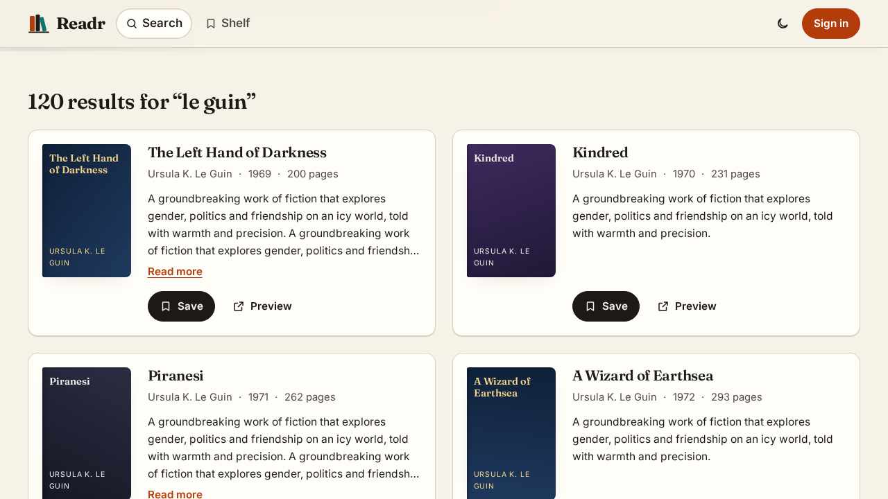
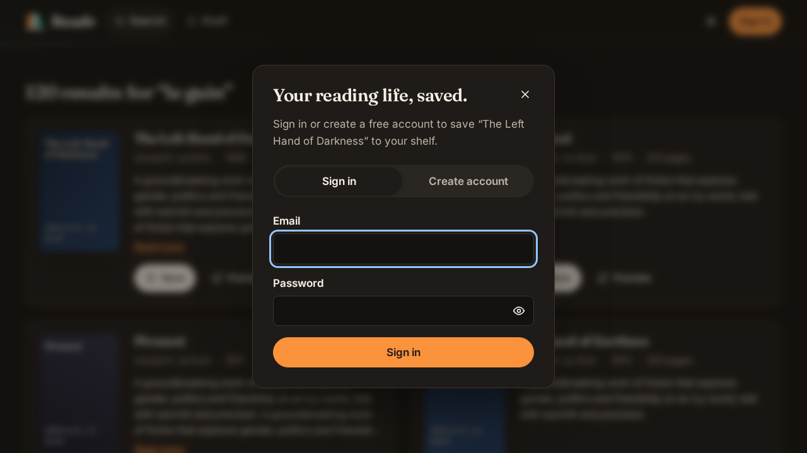
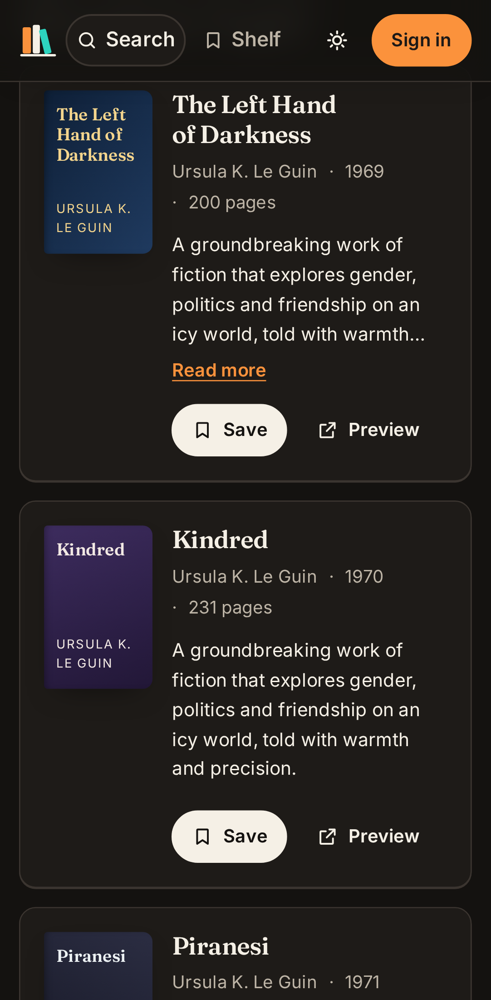

# Readr

Search Google Books and keep a personal reading shelf that follows you across devices.

     

| Home (light) | Results (light) |
| --- | --- |
|  |  |
| **Sign in (dark)** | **Mobile (dark)** |
|  |  |

## What it does

- **Search** millions of books via the Google Books API, with shareable `?q=` URLs, "show more" paging and ⌘K / Ctrl+K to jump to the search box.
- **Save** books to your shelf with one tap (optimistic UI). Signed out? Readr asks you to sign in, then finishes the save for you.
- **Your shelf**: filter, sort (recent, title, author), remove with **Undo**.
- **Light and dark themes** that follow your OS until you choose, with no flash on load.

## Accessibility (WCAG 2.2 AA)

- Semantic landmarks, one `h1` per page, skip link, and focus moved to the page heading on navigation.
- Everything works by keyboard: native `<dialog>` for sign-in (focus trap, Esc, focus return), ARIA tabs with arrow keys, visible 3px focus rings that are never hidden under the sticky header (2.4.11).
- Forms: real labels, `autocomplete` for password managers (3.3.8), inline errors linked with `aria-describedby`, focus sent to the first problem, values kept after an error (3.3.7), show-password toggle.
- Live regions announce search progress, result counts and toasts. Toasts with actions (Undo) never time out (2.2.1).
- Colour contrast is tested for both themes: body text ≥ 15:1, muted text ≥ 7:1, accents ≥ 4.5:1, focus ≥ 3:1.
- Targets ≥ 24px (most are 44px) (2.5.8), reflows to 320px without horizontal scroll (1.4.10), `prefers-reduced-motion` turns animations off, Windows High Contrast supported.
- Automated: axe-core in unit tests and in Playwright (desktop + mobile, light + dark) against the production build.

## Stack

| Part      | Tech                                                                                                 |
| --------- | ---------------------------------------------------------------------------------------------------- |
| Client    | React 19 (Actions, `useActionState`, `use`), React Router 8 (data router, view transitions), Apollo Client 4, Vite 8, TypeScript 7 |
| Styling   | Hand-written modern CSS: `light-dark()`, container queries, scroll-driven animations, `@starting-style`, view transitions. Fraunces + Inter variable fonts, self-hosted |
| Server    | Node 24 running TypeScript natively (type stripping, no build), Express 5, Apollo Server 5, Mongoose 9, `jose` JWTs, `bcryptjs`, zod-validated env, helmet + CORS + rate limiting |
| Tooling   | npm workspaces, oxlint (incl. jsx-a11y), Prettier, Vitest 5, Testing Library, Playwright + axe, GitHub Actions |

```
client/   Vite + React app (src/pages, src/components, src/lib)
server/   GraphQL API (src/graphql, src/models)
```

## Run locally

Requires Node 24+ and a MongoDB (local `mongod`, Docker, or an Atlas connection string).

```sh
git clone https://github.com/leoelicos/readr.git
cd readr
npm install
cp .env.example server/.env   # then edit MONGODB_URI / JWT_SECRET
npm run dev                   # API on :3001, client on http://localhost:5173
```

## Scripts

| Command              | What it does                                                  |
| -------------------- | ------------------------------------------------------------- |
| `npm run dev`        | API (watch mode) + Vite dev server                            |
| `npm run build`      | Type-check and build the client to `client/dist`              |
| `npm start`          | Start the API (serves `client/dist` too when `NODE_ENV=production`) |
| `npm run lint`       | oxlint                                                        |
| `npm run typecheck`  | `tsc` for client and server                                   |
| `npm test`           | Vitest: client (jsdom + axe) and server (in-memory MongoDB)   |
| `npm run test:a11y`  | Build, then Playwright + axe across themes and viewports      |
| `npm run check`      | Everything CI runs                                            |

## Configuration

Server (`server/.env` locally, dashboard env vars in production). See [`.env.example`](./.env.example).

| Variable       | Required          | Notes                                                    |
| -------------- | ----------------- | -------------------------------------------------------- |
| `MONGODB_URI`  | production        | MongoDB Atlas connection string                          |
| `JWT_SECRET`   | **production**    | ≥ 32 random characters. The API refuses to start without it |
| `JWT_TTL`      | no (`2h`)         | Login lifetime                                           |
| `CORS_ORIGINS` | when split-hosted | Comma-separated client origins, e.g. your Vercel URL     |
| `PORT`         | no (`3001`)       |                                                          |

Client (build-time, public):

| Variable                     | Notes                                                                      |
| ---------------------------- | -------------------------------------------------------------------------- |
| `VITE_GRAPHQL_URL`           | API endpoint. Set in `client/.env.production` to the Render API            |
| `VITE_GOOGLE_BOOKS_API_KEY`  | Optional, referrer-restricted key to avoid anonymous Google rate limits    |

## Deploy

- **Client (Vercel)**: root directory `client`. `client/vercel.json` sets the Vite preset, `dist` output, SPA rewrites and cache headers.
- **API (Render)**: build `npm install`, start `npm start`, Node version from `.node-version`. Set the env vars above.

## License

© Leo Wong <leoelicos@gmail.com>. MIT.
